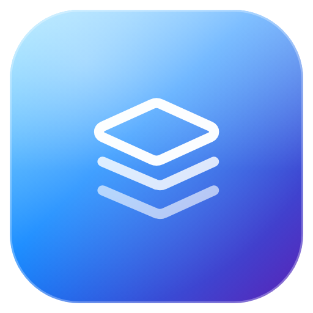
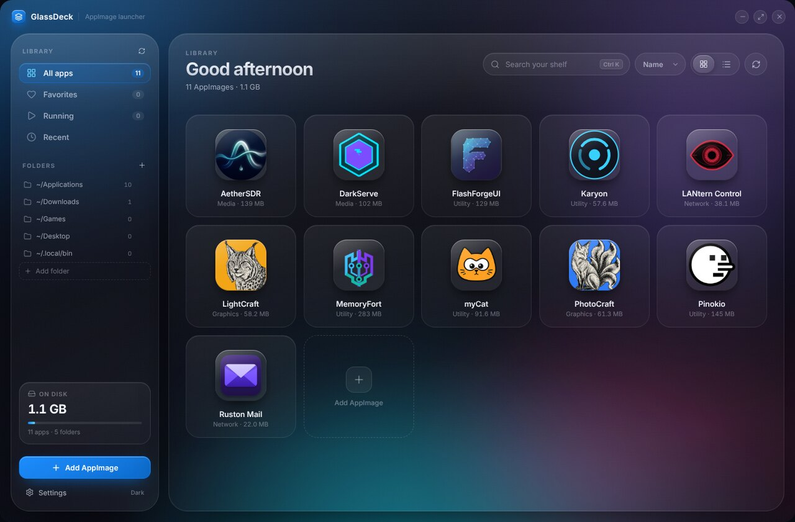
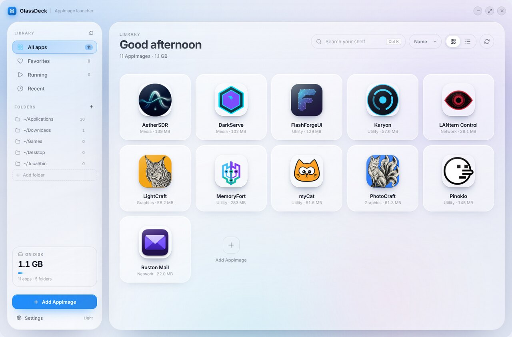
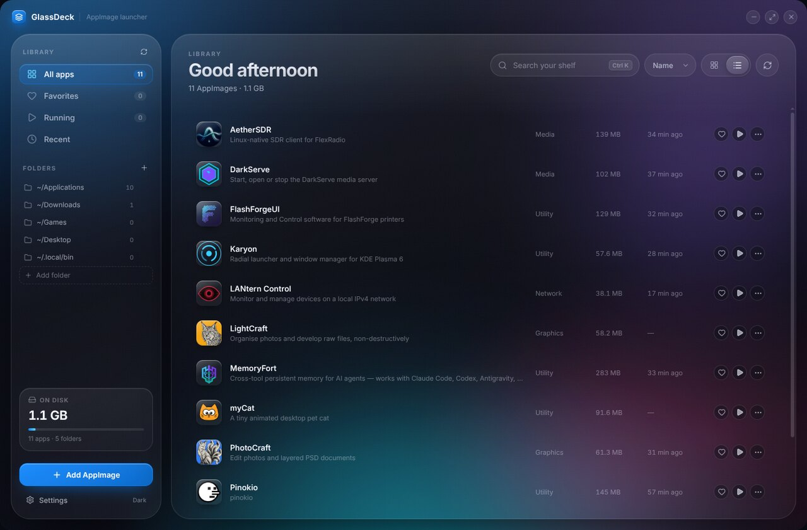
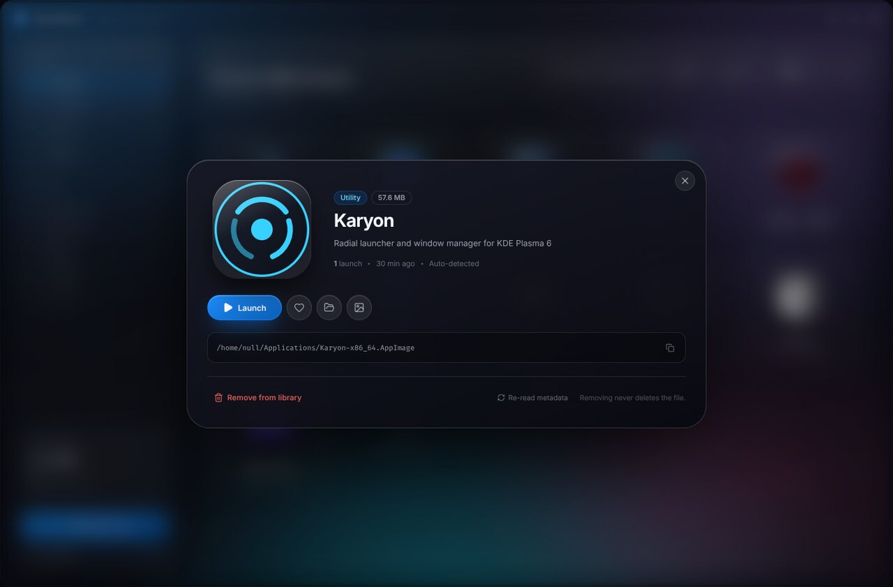

<div align="center">
  
  <h1>GlassDeck</h1>
  <p><strong>Your AppImages, on a glass shelf.</strong></p>
  <p>A small, local-only AppImage launcher for Linux with an interface that feels a bit like iOS.</p>

  <p>
    
    <a href="LICENSE"></a>
    
    
    
    
    
  </p>
</div>



## Why this exists

AppImages are lovely: one file, no installation, works on almost any distro. But they
pile up in `~/Downloads`, they never show up in your app menu, and every so often one
refuses to start because it's missing the execute bit.

GlassDeck is a small answer to that. Point it at the folders where your AppImages live
and it builds a clean shelf: real names, real icons, descriptions, favorites, and a
play button. Everything stays on your machine — nothing is uploaded, moved, or deleted.

Built with Electron, React and TypeScript. The glass is hand-written CSS.

## What it does

- **Finds your AppImages.** Scans `~/Applications`, `~/Downloads`, `~/Games`,
  `~/Desktop`, `~/.local/bin`, and any folders you add.
- **Shows the real thing.** Names, icons, descriptions and versions are read straight
  out of each AppImage — no more `SomeApp-1.2.3-x86_64.AppImage` in a list.
- **Launches and stops apps.** One click to open; a green dot shows what's running.
- **Fixes the permissions dance.** If a file isn't executable, GlassDeck offers to fix it.
- **Works without FUSE.** If mounting fails, it quietly retries in extract mode.
- **Remembers what you like.** Favorites, recents, custom names and icons, light/dark/auto,
  six accent colors.
- **Looks the part.** Frosted glass panels, a rounded window, springy cards, and drag &
  drop for adding files.
- **Stays quiet.** No accounts, no telemetry, no network calls. Idle CPU is effectively zero.

## A closer look

| Light theme | List view |
| :---: | :---: |
|  |  |



## Install

You'll need Linux, Node.js 20.19+ (or 22+), and [`squashfs-tools`](https://github.com/plougher/squashfs-tools)
so GlassDeck can read icons and names:

```bash
sudo apt install squashfs-tools      # Debian, Ubuntu, Kali
sudo dnf install squashfs-tools      # Fedora
sudo pacman -S squashfs-tools        # Arch
```

Then install it for your user — no sudo, nothing outside your home folder:

```bash
npm install
npm run dist          # build the packaged app
npm run install:user  # install it into ~/.local
```

This gives you a **GlassDeck** entry in your app menu and a `glassdeck` command:

```bash
glassdeck
```

Updating later is just:

```bash
npm run dist && npm run install:user
```

`npm run dist` also builds a portable AppImage in `release/`. If your distro is
missing `libfuse2`, run it with:

```bash
APPIMAGE_EXTRACT_AND_RUN=1 ./release/GlassDeck-0.1.0.AppImage
```

### Run from source

```bash
npm install
npm run dev
```

## Keyboard

| Shortcut | What it does |
| --- | --- |
| `Ctrl` `K` | Jump to search |
| `Ctrl` `R` | Rescan your folders |
| `Esc` | Close a sheet or clear the search |
| `Enter` / `Space` | Launch the focused card |

You can also drop `.AppImage` files anywhere on the window to add them.

## Where it keeps things

Settings, your library and cached icons live in `~/.config/GlassDeck/`. Delete that
folder to start over. Your AppImage files are never touched.

<details>
<summary>How the metadata is read</summary>

An AppImage is an ELF runtime with a squashfs filesystem attached to it. GlassDeck
finds that filesystem inside the file, asks `unsquashfs` to list it, then copies out
only the `.desktop` entry and the best icon. The result is cached by file size and
modification time, so rescans are quick.

</details>

<details>
<summary>Project layout</summary>

- `electron/main.cjs` — scanning, metadata, launching, IPC
- `electron/preload.cjs` — the safe bridge to the UI
- `src/` — React interface
- `src/styles.css` — the glass design system
- `build/` — app icon

</details>

## If something's off

**Icons or names are missing.** Install `squashfs-tools`. Without it, GlassDeck still
lists your apps but falls back to filenames and letter icons.

**An AppImage won't start.** GlassDeck retries with extract mode on its own. You can
also flip that on permanently under *Settings → Extract mode*, or make the file
executable with `chmod +x` (the app can do that for you too).

**The fan spins up.** The animated background is off by default. If you turned on
*Settings → Living background*, that's the cost on machines without GPU acceleration.
*Reduce motion* turns off every animation, too.


**The menu entry doesn't show up.** Run `kbuildsycoca6`, or log out and back in once.

## License

MIT. Use it, change it, ship it. Bugs and ideas are welcome — open an issue.
